# Introducción

El **Aula Virtual** es el portal donde los alumnos de IDH ven sus cursos, talleres y webinars: las clases grabadas, los materiales y su certificado. Así ya no hace falta enviarles los enlaces uno por uno por WhatsApp.

Este manual es para el **personal de IDH** que administra a los alumnos. Explica cómo:

- registrar alumnos (uno por uno o importándolos desde Excel),
- matricularlos en los cursos,
- controlar los pagos y bloquear el acceso cuando haga falta,
- cargar los certificados.

> La creación de cursos, clases y la biblioteca de recursos no forman parte de este manual.

## Cómo entrar

1. Ingresa al panel de WordPress del sitio (`/wp-admin`) con tu usuario de **administrador**.
2. En el menú lateral, abre **Aula Virtual**.

Las opciones que usarás en este manual son:

| Menú | Para qué sirve |
|---|---|
| **Alumnos** | Ver, buscar, registrar, editar y bloquear alumnos. |
| **Matrículas** | Ver todas las matrículas, matricular alumnos y cambiar pagos o accesos. |
| **Importar alumnos** | Registrar muchos alumnos a la vez desde un archivo CSV (Excel). |
| **Ajustes** | Configurar el número de WhatsApp de IDH al que escriben los alumnos. |

## Conceptos clave

| Concepto | Qué significa |
|---|---|
| **Alumno** | Persona registrada con su DNI. Ingresa al aula con su **DNI** y su **fecha de nacimiento**; no necesita contraseña. |
| **Matrícula** | Relación entre un alumno y un curso. Un alumno puede tener varias matrículas, una por curso. |
| **Estado de pago** | Cada matrícula está **Pagada** o **Pendiente**. Solo las pagadas cuentan en los reportes. |
| **Candado (bloquear curso)** | Bloquea **un solo curso** de un alumno. El curso aparece con un candado y el alumno no puede entrar a él. |
| **Bloquear alumno** | Bloquea **todo** el acceso del alumno al aula: no puede ingresar ni descargar sus certificados. |
| **Certificado** | Pertenece a cada matrícula. Puede ser un **enlace externo** (por ejemplo, el QR de qr.io) o un **PDF subido**, con un enlace opcional al verificador. |

---

# Alumnos

## Listado de alumnos

En **Aula Virtual → Alumnos** ves a todos los alumnos registrados.

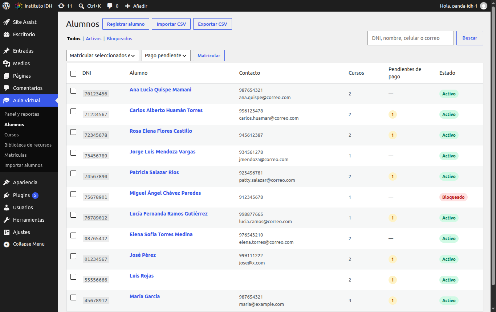

Qué muestra cada columna:

- **DNI**: es el usuario con el que el alumno ingresa.
- **Alumno**: haz clic en el nombre para abrir su ficha.
- **Contacto**: celular y correo.
- **Cursos**: en cuántos cursos está matriculado.
- **Pendientes de pago**: cuántas de sus matrículas están pendientes (en amarillo).
- **Estado**: **Activo** o **Bloqueado**.

Además puedes:

- **Buscar** por DNI, nombre, celular o correo con el buscador de la derecha.
- **Filtrar** con los enlaces **Todos | Activos | Bloqueados**.
- **Exportar CSV**: descarga el listado (con el filtro y la búsqueda aplicados) para abrirlo en Excel.

Si pasas el mouse sobre el nombre de un alumno aparecen dos accesos rápidos: **Ver / editar** (su ficha) y **Matrículas** (sus matrículas en la pantalla de Matrículas).

## Registrar un alumno

1. En **Alumnos**, haz clic en **Registrar alumno**.
2. Completa los datos. Los que tienen asterisco (\*) son obligatorios:
   - **DNI**: 8 dígitos. Es el usuario de acceso del alumno y no se puede repetir.
   - **Fecha de nacimiento**: el alumno la usa como segundo dato para ingresar. **Verifícala bien**, porque si está mal el alumno no podrá entrar.
   - **Nombres** y **Apellidos**.
   - **Celular** y **Correo** (opcionales).
   - **Notas internas** (opcionales): solo las ve el personal de IDH.

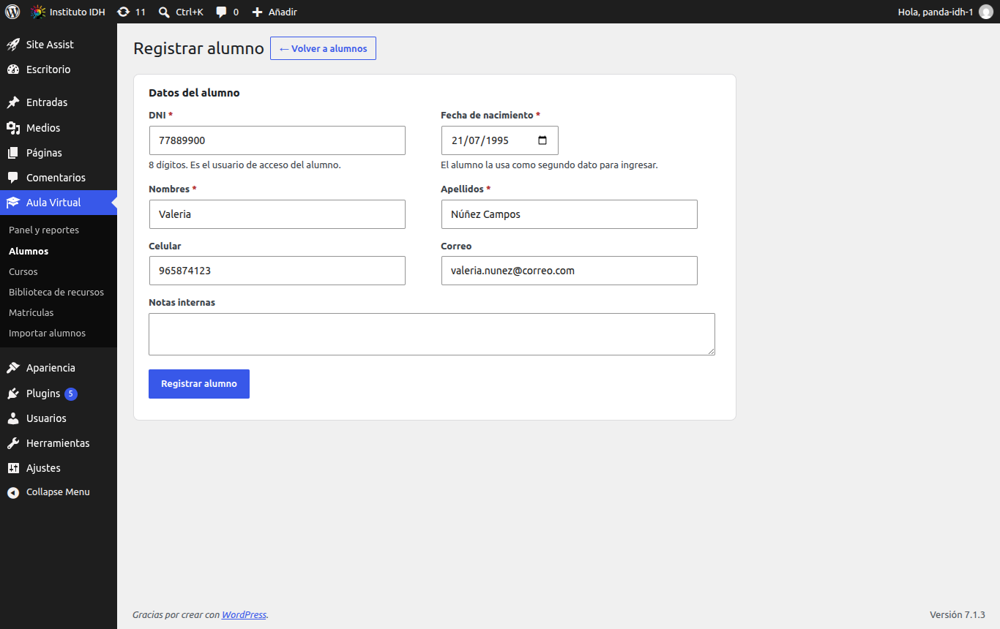

3. Haz clic en **Registrar alumno**.

Se abre la **ficha del alumno** con el mensaje *«Alumno registrado. Ahora puedes matricularlo en sus cursos.»*

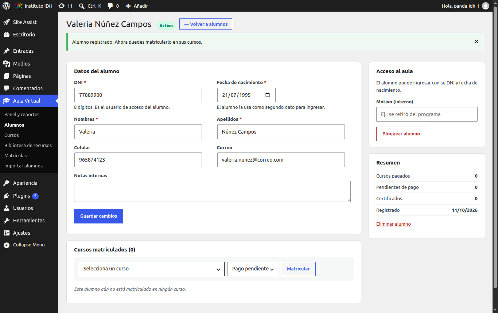

> **Importante:** registrar a un alumno **no** le da acceso a ningún curso. Después tienes que **matricularlo** (ver el capítulo *Matricular alumnos*).

## Ficha del alumno

La ficha reúne todo lo de un alumno:

- **Datos del alumno**: puedes corregirlos y guardar con **Guardar cambios**.
- **Cursos matriculados**: sus matrículas, con el pago, el candado y el certificado de cada una.
- **Acceso al aula** (a la derecha): para bloquear o desbloquear al alumno.
- **Resumen**: cuántos cursos tiene pagados, cuántos pendientes, cuántos certificados y su fecha de registro.

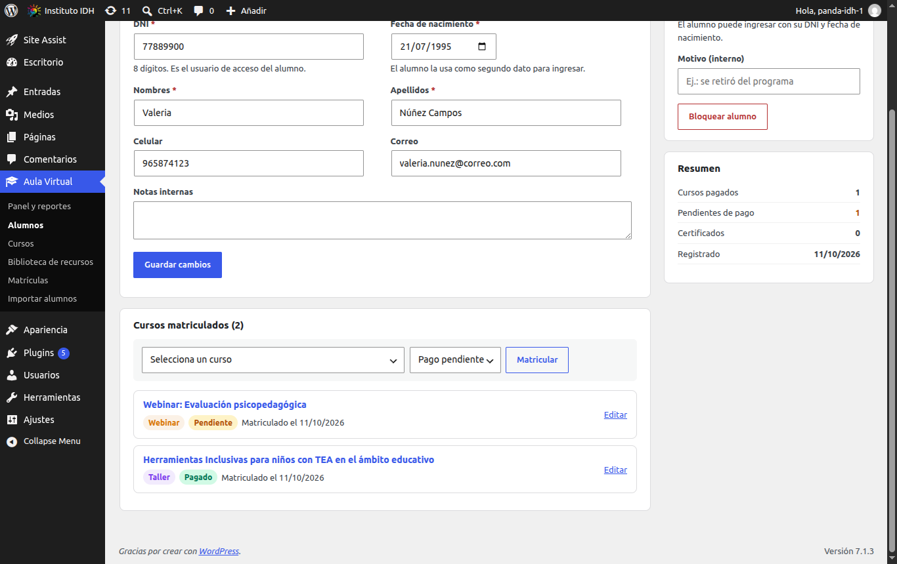

Cada matrícula muestra etiquetas de colores:

| Etiqueta | Significado |
|---|---|
| **Curso / Webinar / Taller** | Categoría del curso. |
| **Pagado** (verde) / **Pendiente** (amarillo) | Estado de pago. |
| **🔒 Bloqueado** (rojo) | El curso tiene candado. |
| **Certificado** (verde) | Ya tiene certificado cargado. |
| **Curso en borrador** | El curso aún no está publicado; el alumno todavía no lo ve. |

### Eliminar a un alumno

Solo puedes eliminar a un alumno que **no tenga matrículas**. En ese caso aparece el enlace **Eliminar alumno** en el recuadro *Resumen*. Si ya tiene matrículas, usa **Bloquear alumno**.

---

# Matricular alumnos

Hay cinco formas de matricular. Todas hacen lo mismo; elige la más cómoda para cada caso:

| Caso | Dónde |
|---|---|
| Un alumno en un curso, desde su ficha | **Ficha del alumno → Cursos matriculados** |
| Uno o varios alumnos buscándolos por nombre o DNI | **Matrículas → Matricular alumno** |
| Una lista de DNIs (por ejemplo, copiada de un Excel o de WhatsApp) | **Matrículas → Matrícula masiva** |
| Alumnos que ves en el listado | **Alumnos → casillas + Matricular seleccionados en…** |
| Alumnos nuevos que aún no están registrados | **Importar alumnos** (registra y matricula a la vez) |

En todas eliges el **estado de pago inicial** (Pendiente o Pagado). El **precio** de la matrícula se copia del precio del curso; luego puedes cambiarlo en la matrícula.

Si el alumno ya estaba matriculado en ese curso, el sistema no lo duplica: solo te avisa.

## Desde la ficha del alumno

1. Abre la ficha del alumno.
2. En **Cursos matriculados**, elige el curso y el estado de pago.
3. Haz clic en **Matricular**.

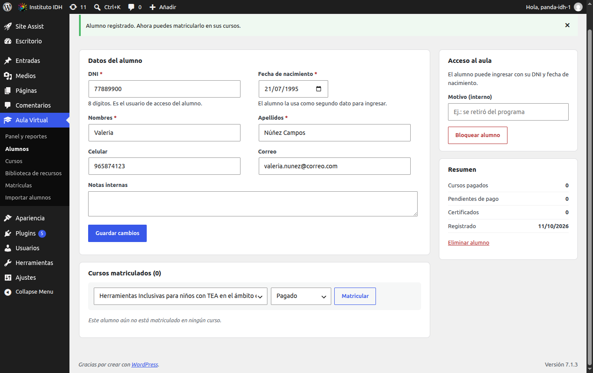

## Matricular alumno (búsqueda por nombre o DNI)

Sirve cuando no tienes el DNI a mano o quieres matricular a pocos alumnos.

1. Ve a **Aula Virtual → Matrículas** y haz clic en **Matricular alumno**.
2. Elige el **Curso** y el **Estado de pago inicial**.
3. En **Alumno**, escribe al menos 2 caracteres del **DNI**, del **nombre** o del **apellido**. No importan las tildes.
4. Haz clic en el alumno de la lista para agregarlo. Puedes agregar varios.
   - Los que ya están en ese curso aparecen en gris con el aviso **«Ya matriculado»** y no se pueden elegir.
   - Si un alumno está bloqueado aparece el aviso **«Alumno bloqueado»**. Puedes matricularlo, pero no podrá entrar hasta que lo desbloquees.

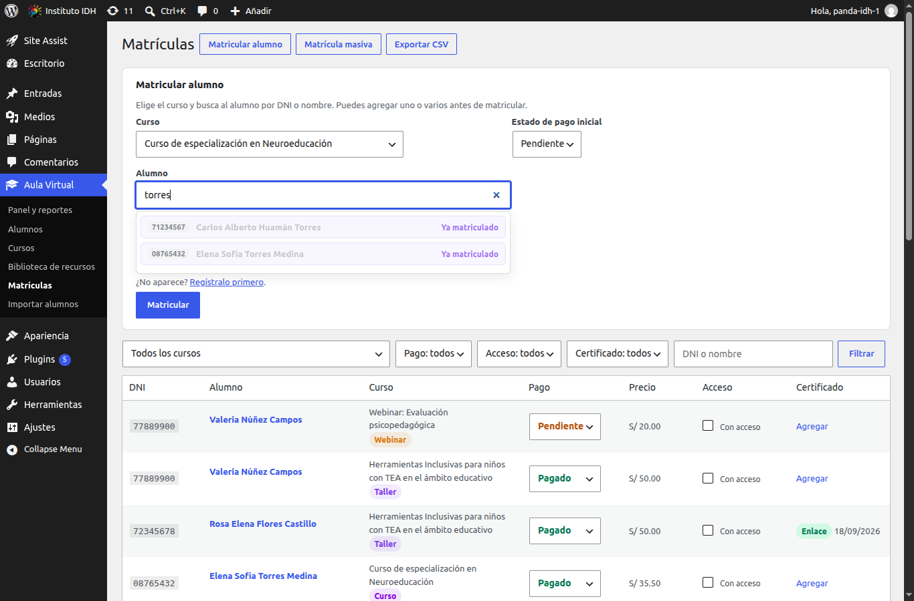

5. Revisa a los alumnos agregados. Para quitar uno, usa la **×**.

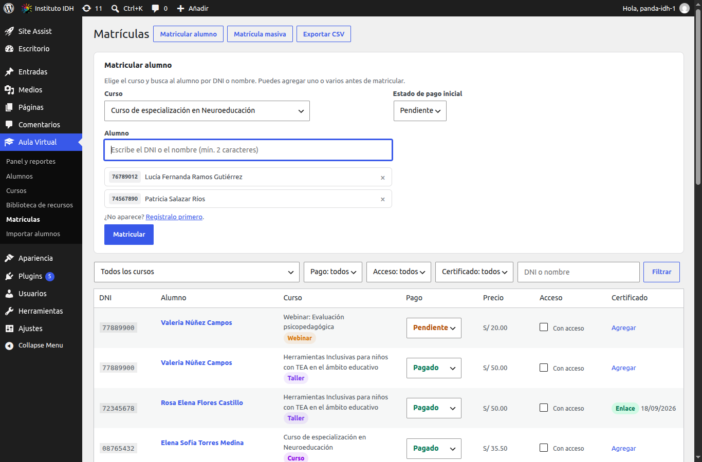

6. Haz clic en **Matricular**.

La pantalla muestra el listado de ese curso con el mensaje de confirmación:

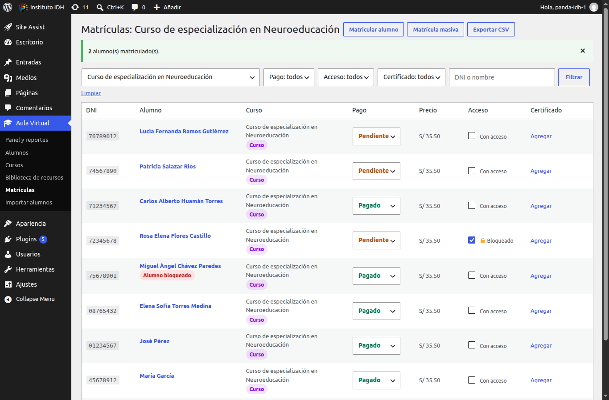

> **Atajos de teclado:** **Enter** agrega el primer resultado y **Esc** cierra la lista.
> Si el alumno no aparece, todavía no está registrado: usa el enlace **«Regístralo primero»**.

## Matrícula masiva (lista de DNIs)

Sirve para matricular a un grupo grande cuando ya tienes sus DNIs.

1. Ve a **Matrículas** y haz clic en **Matrícula masiva**.
2. Elige el **Curso** y el **Estado de pago inicial**.
3. Pega los **DNIs**: uno por línea, o separados por comas o espacios.
4. Haz clic en **Matricular**.

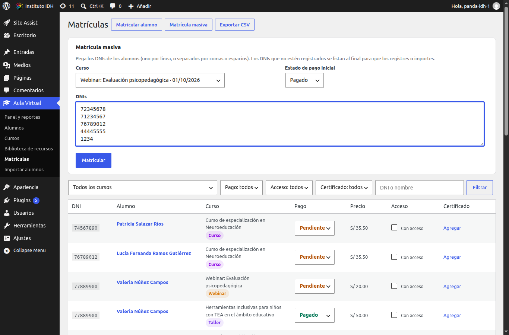

Al terminar, el sistema muestra un resumen:

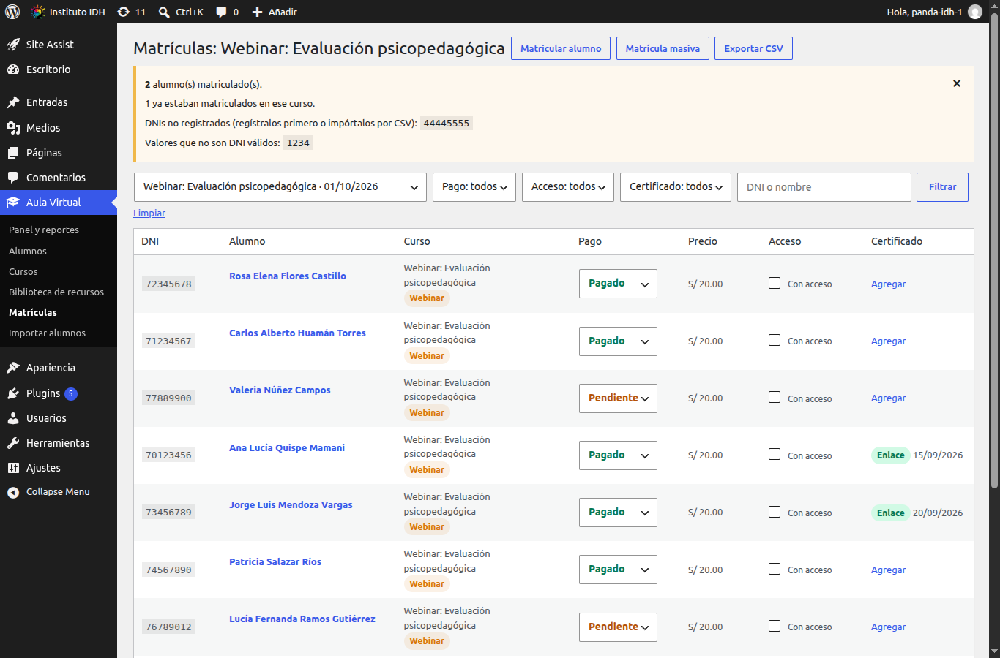

- **Alumnos matriculados**: los que se agregaron al curso.
- **Ya estaban matriculados**: no se tocaron.
- **DNIs no registrados**: no existen en el sistema. Regístralos o impórtalos y vuelve a matricularlos.
- **Valores que no son DNI válidos**: por ejemplo, números con menos dígitos o con letras.

## Desde el listado de alumnos

1. En **Alumnos**, marca las casillas de los alumnos.
2. Arriba de la tabla, elige el curso en **Matricular seleccionados en…** y el estado de pago.
3. Haz clic en **Matricular**.

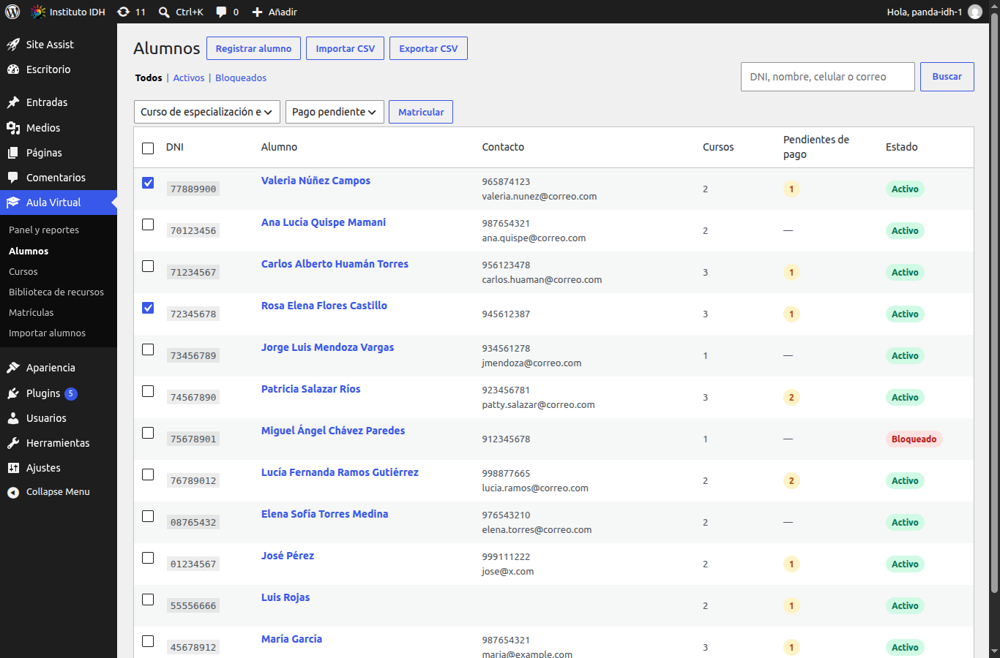

---

# Gestionar una matrícula

Cada matrícula tiene su **pago**, su **precio**, su **candado** y su **certificado**. Puedes cambiarlos desde la ficha del alumno o desde el listado de **Matrículas**.

## Editar desde la ficha del alumno

1. Abre la ficha del alumno.
2. En la matrícula que quieras cambiar, haz clic en **Editar**.
3. Cambia lo que necesites y haz clic en **Guardar matrícula**.

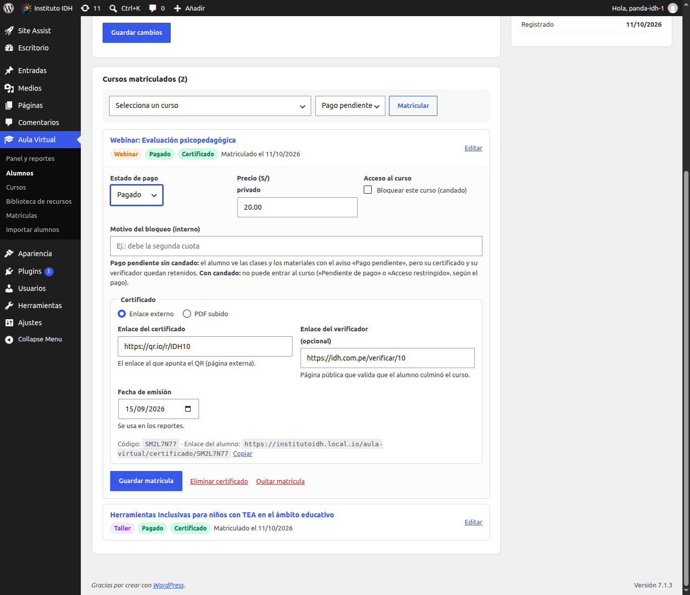

Campos:

- **Estado de pago**: Pendiente o Pagado.
- **Precio (S/)**: lo que paga este alumno por el curso. Es **privado**: el alumno no lo ve.
- **Bloquear este curso (candado)**: impide que el alumno entre a este curso.
- **Motivo del bloqueo (interno)**: una nota para el personal; el alumno no la ve. Por ejemplo, *«debe la segunda cuota»*.

### Pago pendiente vs. candado

| Situación | Qué ve el alumno |
|---|---|
| **Pagado**, sin candado | Todo: clases, materiales y certificado. |
| **Pendiente**, sin candado | Las clases y los materiales con el aviso **«Pago pendiente»**. El **certificado y el verificador quedan retenidos** hasta que la matrícula pase a *Pagado*. |
| **Pendiente**, con candado | El curso aparece con candado y el mensaje **«Pendiente de pago»**. No puede entrar. |
| **Pagado**, con candado | El curso aparece con candado y el mensaje **«Acceso restringido»**. No puede entrar. |

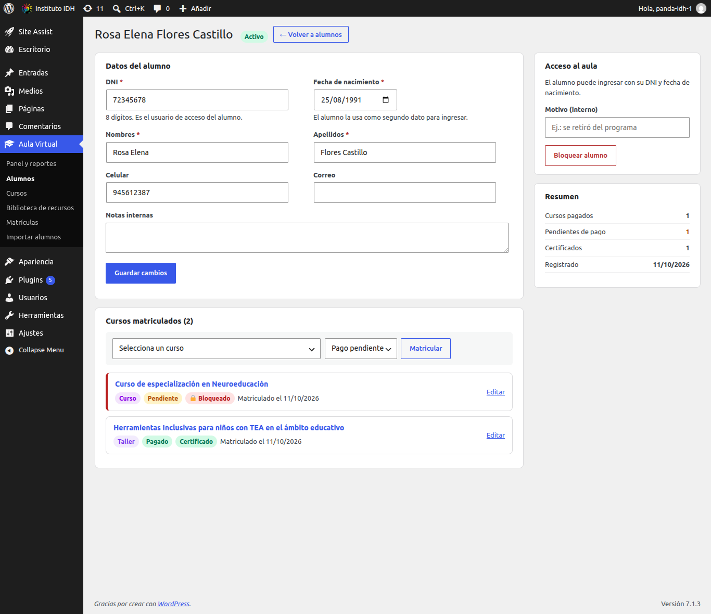

## Cargar el certificado

El certificado se carga en la misma edición de la matrícula, en el recuadro **Certificado**. Hay dos modos.

**Enlace externo**: para certificados que ya tienen una página, por ejemplo, el QR de qr.io.

- **Enlace del certificado**: la dirección a la que apunta el QR.

**PDF subido**: para subir el archivo del certificado.

- **Archivo PDF**: hasta 15 MB. Se guarda en una carpeta privada y solo se entrega al alumno si no está bloqueado. Para reemplazarlo, sube otro.

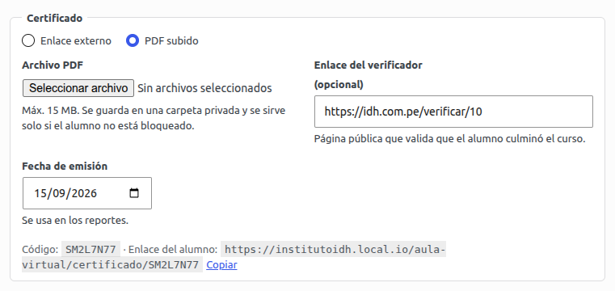

En los dos modos:

- **Enlace del verificador** (opcional): la página pública que valida que el alumno culminó el curso.
- **Fecha de emisión**: se usa en los **reportes** de certificados emitidos. Pon la fecha real de emisión. Es un dato **interno**: el alumno no la ve en el aula virtual.

Al guardar, el sistema asigna al certificado un **código** y un **enlace del alumno**, que puedes copiar con **Copiar**.

Para borrar el certificado, usa **Eliminar certificado**.

## Quitar una matrícula

En la edición de la matrícula, el enlace **Quitar matrícula** saca al alumno del curso y **borra también su certificado**.

> Si el alumno solo debe dinero, **no quites la matrícula**: márcala como *Pendiente* o ponle candado.

## Listado de matrículas

En **Aula Virtual → Matrículas** ves todas las matrículas de todos los cursos.

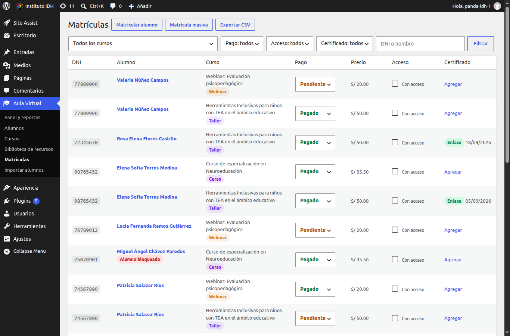

**Filtros**: elige uno o más y haz clic en **Filtrar**. Con **Limpiar** vuelves a ver todo.

- **Curso**.
- **Pago**: pagados o pendientes.
- **Acceso**: con acceso o bloqueados (candado).
- **Certificado**: con certificado o sin certificado.
- **DNI o nombre**.

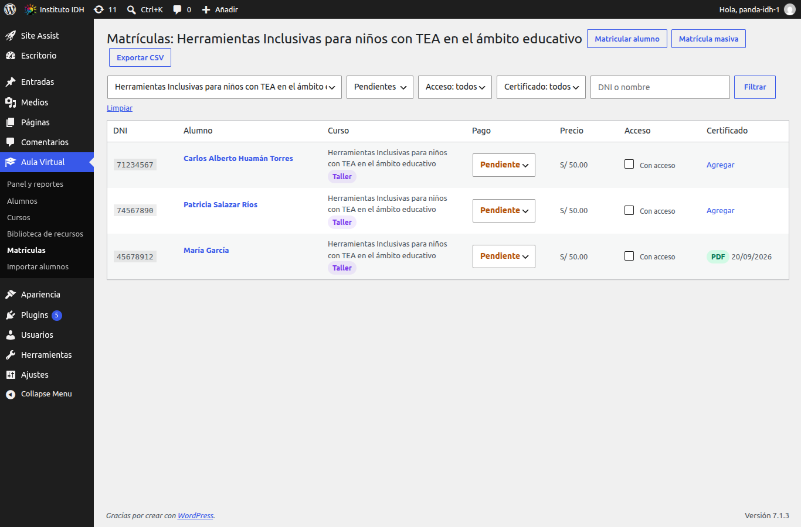

**Cambios rápidos** (se guardan al instante, sin botón de guardar):

- **Pago**: cambia entre *Pendiente* y *Pagado* con la lista desplegable.
- **Acceso**: marca la casilla para poner el candado y desmárcala para quitarlo.

**Otras acciones:**

- **Certificado → Agregar**: abre la ficha del alumno en esa matrícula para cargar el certificado.
- **Exportar CSV**: descarga las matrículas con los filtros aplicados.
- La etiqueta roja **«Alumno bloqueado»** junto al nombre indica que el alumno tiene todo su acceso bloqueado.

> **Ejemplo:** para ver quién debe un curso, filtra por ese **Curso** y **Pago: Pendientes**.

---

# Importar alumnos desde Excel (CSV)

Sirve para registrar a muchos alumnos de una vez y, si quieres, matricularlos en un curso en el mismo paso.

## 1. Preparar el archivo

1. En **Aula Virtual → Importar alumnos**, haz clic en **Descargar plantilla**.
2. Ábrela en Excel y completa una fila por alumno con estas columnas:

| Columna | Obligatoria | Ejemplo |
|---|---|---|
| `dni` | Sí | 70123456 |
| `nombres` | Sí | Ana Lucía |
| `apellidos` | Sí | Quispe Mamani |
| `fecha_nacimiento` | Sí | 12/05/1994 (dd/mm/aaaa) |
| `celular` | No | 987654321 |
| `correo` | No | ana@correo.com |
| `curso_id` | No | Número del curso en el que se matricula ese alumno |

3. Guarda el archivo con **Archivo → Guardar como → CSV UTF-8**. El separador puede ser coma o punto y coma.

> **¿Excel no separa bien las columnas?** Según la configuración de Windows, Excel usa coma o punto y coma como separador. El sistema acepta los dos, pero si al abrir el archivo todo aparece en una sola columna, usa **Google Sheets**: **Archivo → Importar** para abrirlo y **Archivo → Descargar → Valores separados por comas (.csv)** para guardarlo.

> Si Excel le quita el cero inicial a un DNI (por ejemplo, `7801234` en lugar de `07801234`), el sistema lo completa solo hasta 8 dígitos.

## 2. Subir y revisar la vista previa

1. Elige el archivo en **Archivo (.csv)**.
2. Opcional: en **Matricular a todos en**, elige un curso. Si el archivo trae la columna `curso_id`, esa columna tiene prioridad.
3. Elige el **Estado de pago inicial** de las matrículas.
4. Haz clic en **Ver vista previa**. **Todavía no se guarda nada.**

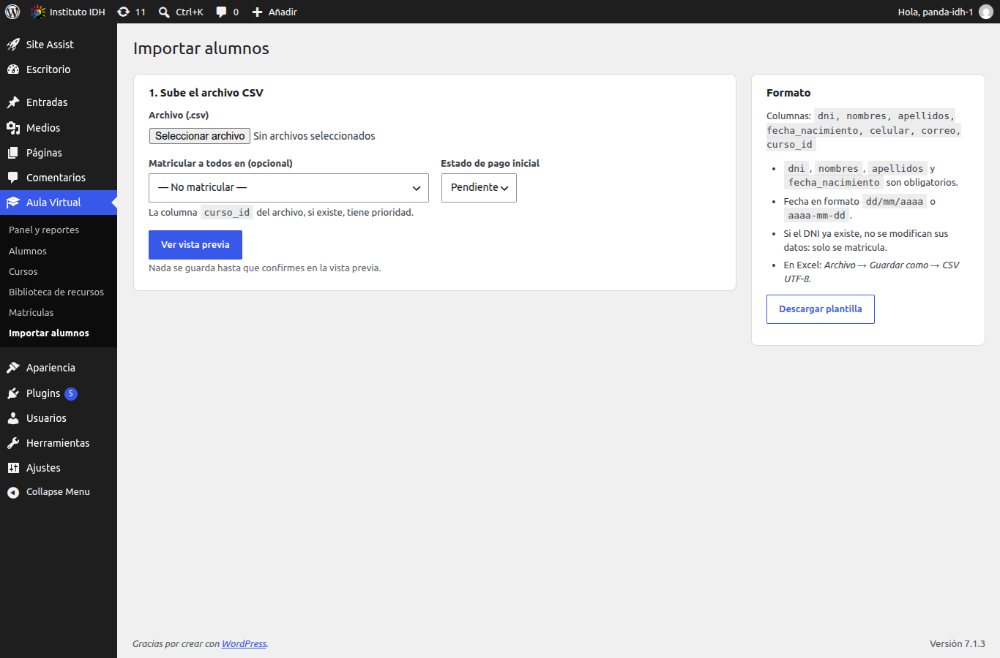

La vista previa muestra cada fila con su estado:

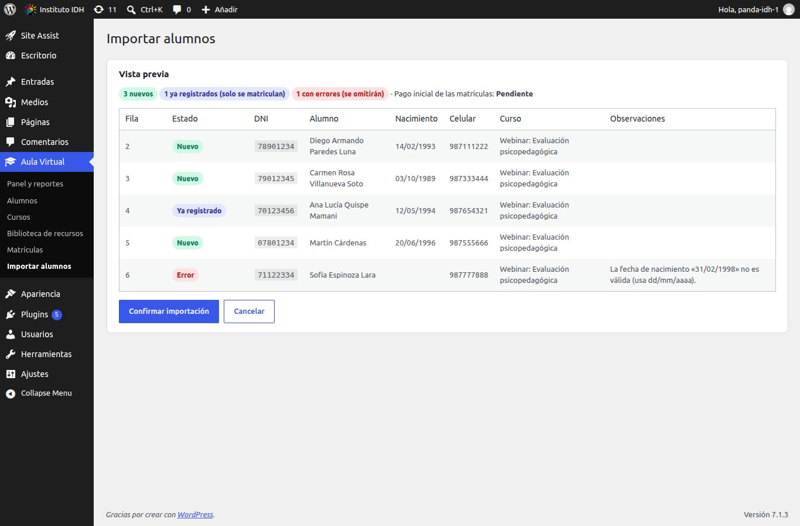

| Estado | Qué pasará |
|---|---|
| **Nuevo** | Se registra el alumno (y se matricula, si elegiste un curso). |
| **Ya registrado** | El DNI ya existe: **no se cambian sus datos**, solo se matricula. |
| **Error** | La fila se omite. La columna *Observaciones* explica el motivo, por ejemplo, una fecha inválida. |

## 3. Confirmar

Si todo está bien, haz clic en **Confirmar importación**. Si no, haz clic en **Cancelar**, corrige el archivo y vuelve a subirlo.

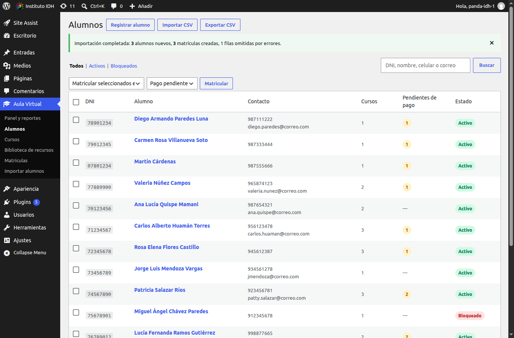

> La vista previa caduca después de un rato. Si ves *«La vista previa expiró»*, vuelve a subir el archivo.

---

# Bloquear y desbloquear a un alumno

Bloquear a un alumno le quita **todo** el acceso al aula. Úsalo, por ejemplo, si se retiró del programa.

**Para bloquear:**

1. Abre la ficha del alumno.
2. En **Acceso al aula**, escribe el **Motivo (interno)**. Es opcional y el alumno no lo ve.
3. Haz clic en **Bloquear alumno** y confirma.

**Efecto inmediato:**

- Si el alumno estaba dentro del aula, su sesión se cierra en el siguiente clic.
- No puede volver a ingresar: ve el mensaje *«Tu acceso al aula virtual está deshabilitado. Comunícate con IDH para más información.»*
- Los certificados en **PDF** dejan de descargarse.
- Sus matrículas y certificados **no se borran**.

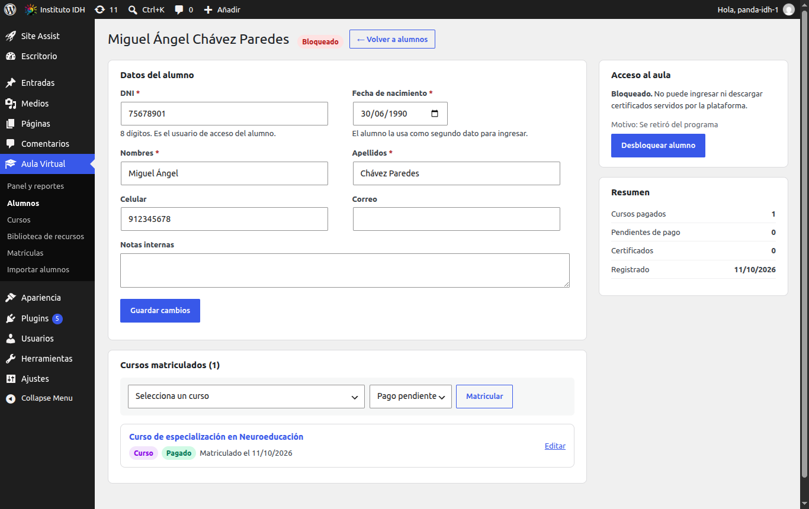

**Para desbloquear**, abre su ficha y haz clic en **Desbloquear alumno**. Recupera el acceso a todo lo que tenía.

> **Bloquear alumno o poner candado a un curso:** si el problema es **un solo curso** (por ejemplo, una deuda), usa el **candado** de esa matrícula. Bloquear al alumno corta el acceso a **todos** sus cursos.

---

# Ajustes: WhatsApp de IDH

En **Aula Virtual → Ajustes** se configura el **número de WhatsApp** al que escriben los alumnos.

1. Escribe el número **con el código de país**, sin espacios ni signos. En Perú es 51 seguido de los 9 dígitos, por ejemplo `51987654321`.
2. Haz clic en **Guardar ajustes**.
3. Usa **Probar el enlace con un mensaje de ejemplo** para confirmar que abre el chat correcto.

Con el número configurado, el alumno ve el botón verde **«Escribir a IDH por WhatsApp»** en estos casos:

| Dónde lo ve | Mensaje que ya va escrito |
|---|---|
| Curso **pendiente de pago con candado** | *«Hola IDH, soy [nombre] (DNI [dni]). Quiero regularizar el pago del curso «[curso]»…»* |
| Curso con **acceso restringido** | *«…Mi acceso al curso «[curso]» aparece restringido en el aula virtual. ¿Me pueden ayudar?»* |
| Alumno **bloqueado** que intenta ingresar | *«…Mi acceso al aula virtual está deshabilitado. ¿Me pueden ayudar?»* |
| Pantalla de ingreso (*«¿Problemas para ingresar?»*) | *«Hola IDH. Tengo problemas para ingresar al aula virtual…»* |

Como el mensaje trae el **DNI**, puedes buscar al alumno directamente en **Alumnos**.

> Si dejas el número vacío, los botones de WhatsApp no se muestran.

---

# Qué ve el alumno

Esta sección sirve para orientar a los alumnos cuando escriben con dudas.

## Ingreso

El alumno entra a **`/aula-virtual`** (por ejemplo, `https://idh.com.pe/aula-virtual`) y escribe su **DNI** y su **fecha de nacimiento**.

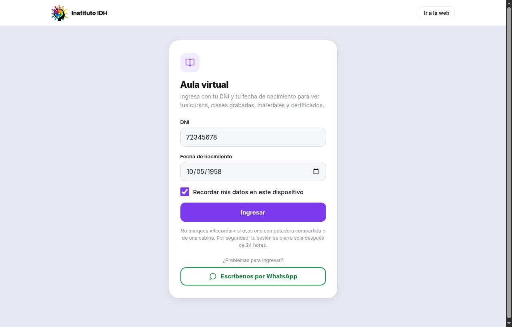

- **Recordar mis datos en este dispositivo:** si el alumno marca esta casilla, la próxima vez el formulario aparece lleno y solo tiene que presionar **Ingresar**. Los datos quedan guardados en su celular o computadora, no en el sistema. Para borrarlos, usa el enlace **Olvidar mis datos**. No conviene marcarla en computadoras compartidas o de cabina.
- **La sesión se cierra sola a las 24 horas.** Después de ese tiempo el alumno vuelve a ingresar; si marcó «Recordar», solo presiona **Ingresar**.

Mensajes que puede ver:

| Mensaje | Causa y solución |
|---|---|
| *«Los datos ingresados no coinciden…»* | El DNI no está registrado o la fecha de nacimiento no coincide. Revisa su ficha. |
| *«…Te quedan 3 intentos antes de que el ingreso se bloquee…»* | Escribió mal sus datos más de una vez. El aviso le indica cuántos intentos le quedan. |
| *«Por seguridad bloqueamos el ingreso temporalmente… Vuelve a intentarlo en 15 minutos.»* | Falló **5 veces** seguidas desde la misma conexión (o 10 veces en una hora con el mismo DNI). Es una protección contra robots: el ingreso queda bloqueado el tiempo indicado, **aunque luego escriba los datos correctos**. Revisa sus datos mientras espera. |
| *«Tu acceso al aula virtual está deshabilitado…»* | El alumno está **bloqueado**. Ve también el botón de WhatsApp. |

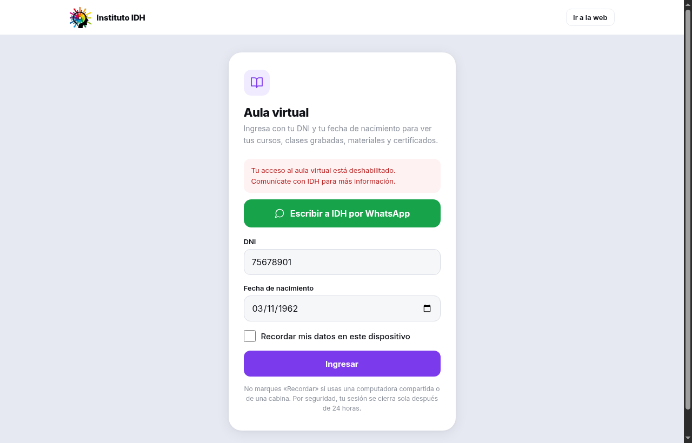

## Mis cursos

Al ingresar, el alumno ve sus cursos en tarjetas y puede filtrarlos por categoría.

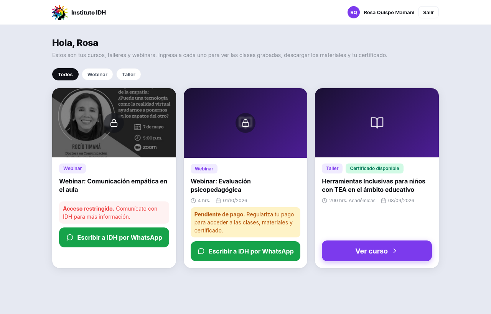

- Cada curso disponible tiene un botón grande **«Ver curso»**.
- Los cursos con **candado** muestran *«Pendiente de pago»* o *«Acceso restringido»*, y el alumno no puede abrirlos. Debajo aparece el botón **«Escribir a IDH por WhatsApp»** con el mensaje ya escrito (ver *Ajustes: WhatsApp de IDH*).
- La etiqueta **«Certificado disponible»** aparece cuando el certificado está cargado y la matrícula está pagada.
- Solo aparecen los cursos **publicados**.

## Detalle del curso

Dentro del curso, cada sesión aparece en un recuadro con dos grupos bien diferenciados:

- **GRABACIONES** (en rojo): los videos de la clase. El botón **«Ver video»** lo abre en el reproductor (en celular, en la app de YouTube).
- **MATERIALES** (en azul): los archivos complementarios, por ejemplo la carpeta de Google Drive. El botón **«Abrir»** los abre en otra pestaña.

Al final están su **certificado** y el **verificador**, con botones para copiar los enlaces.

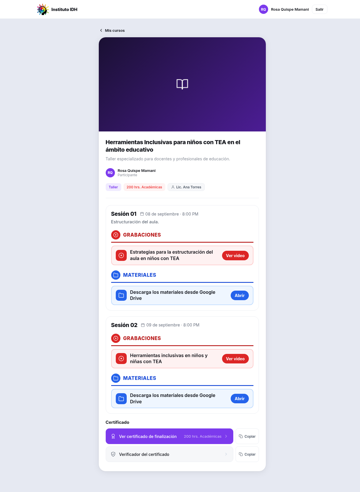

Si la matrícula está **pendiente** (sin candado), ve el aviso «Pago pendiente» y, en lugar del certificado, el aviso **«Certificado retenido»**.

---

# Preguntas frecuentes

**Un alumno dice que no puede entrar.**
Busca su DNI en **Alumnos** y revisa: (1) que exista, (2) que la **fecha de nacimiento** sea correcta y (3) que su estado sea **Activo**. Si escribió mal sus datos 5 veces, debe esperar el tiempo que indica el mensaje (hasta 15 minutos) aunque ya tenga los datos correctos.

**El alumno marcó «Recordar» en una computadora que no es suya.**
Que entre al aula desde esa computadora y haga clic en **Olvidar mis datos**, debajo de la casilla. Si ya no tiene acceso a ella, igual la sesión se cierra sola a las 24 horas, aunque el formulario seguirá lleno en ese equipo.

**Los alumnos no ven el botón de WhatsApp.**
Revisa que el número esté configurado en **Aula Virtual → Ajustes**. El botón solo aparece en cursos con candado, para alumnos bloqueados y en la pantalla de ingreso.

**Un alumno entra, pero no ve un curso.**
Revisa que esté **matriculado** en ese curso y que el curso esté **publicado** (no en borrador).

**Un alumno ve el curso con candado.**
La matrícula tiene el candado activado. Quítalo desde **Matrículas** (columna *Acceso*) o desde su ficha.

**Un alumno no ve su certificado.**
Revisa que la matrícula tenga un certificado cargado y que esté **Pagada**. Si está *Pendiente*, el certificado queda retenido.

**El alumno pagó. ¿Qué hago?**
En **Matrículas**, cambia su pago a **Pagado**. Si tenía candado, quítalo.

**¿Cómo corrijo un DNI o una fecha de nacimiento?**
En la ficha del alumno, corrige el dato y haz clic en **Guardar cambios**. A partir de ese momento, el alumno ingresa con los datos nuevos.

**¿Puedo matricular a un alumno que todavía no está registrado?**
No. Primero regístralo (o impórtalo por CSV) y luego matricúlalo. La importación CSV hace las dos cosas en un solo paso.
